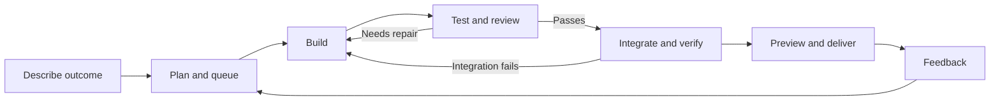

We recommend an autonomous factory: describe an outcome once, then let it plan, build, test, repair, integrate, preview, and deliver. [13](13-current-feature-gaps.md) (product recommendation, 2026-10-17).
The current factory has specs, tasks, and agent launch; its largest product gap is automatic coordination between those stages. [Factory source](../../apps/server/src/index.ts), [launch flow](../../canvas/src/factory/components/start-agent-modal.tsx) (inspected 2026-10-17).
Start with one project and one reliable unattended delivery loop; reuse Canvas/OpenHands execution instead of rebuilding the agent platform. [11](11-autonomous-delivery-loop.md) (recommendation; sources read 2026-10-17).

# Software Factory — product and autonomy research

This summary follows your latest direction: **features, usability, a fully autonomous software factory, and the least possible human intervention**. `docs/RESEARCH_BRIEF.md` was left unchanged. The primary reading is now **10–13**; the earlier **01–09** reports remain supporting platform/federal research, and do not set this roadmap's priorities.

## The product to build

**Proposed experience:** connect a project once, describe the result, select **Build it**, and return to working software. The factory resolves routine details, creates its own work orders, starts the next task, tests the actual application, reviews and repairs the changes, integrates them, and delivers to the configured destination. It remembers project decisions and only asks about a genuine unresolved decision or blocked boundary. This is our recommended target, not functionality already implemented. [Current gaps](13-current-feature-gaps.md), [proposed loop](11-autonomous-delivery-loop.md), [usability](12-usability-and-human-intervention.md) (analysis dated 2026-10-17).

This diagram is **our proposed workflow**. Policy/settings are selected once for the project/run; ordinary transitions run automatically. A person can inspect, pause, redirect, or stop it at any time. [Design basis](11-autonomous-delivery-loop.md) (recommendation dated 2026-10-17).

## Top 10 recommendations, ranked by product impact

These are **our engineering estimates in working days**, for an engineer familiar with this repository, assuming usable agent credentials and a project with scriptable startup/tests. They exclude external service setup and are **not additive**: several rows share the same coordinator and UI work. Links identify the research file and primary evidence; all cited web sources were read **2026-10-17**.

| Rank | Build this feature | What changes for the user | Effort guess | Research / supporting source |
| --- | --- | --- | --- | --- |
| **1** | **Autonomous run coordinator** | One goal creates a plan/queue, dispatches ready work, observes results, and continues until the configured outcome is delivered. No “start next work order” loop. | **4–6 days** for initial sequential coordination | [11 — execution loop](11-autonomous-delivery-loop.md), [13 — current gap](13-current-feature-gaps.md). OpenHands already documents [resumable conversation goals](https://docs.openhands.dev/sdk/guides/agent-server/conversation-goals) (undated; read 2026-10-17); factory coordination remains our proposed layer. |
| **2** | **Automatic test → review → repair** | The factory catches failures, diagnoses them, fixes them, and reruns checks before continuing. Failed work returns to the agent automatically. | **4–6 days** | [11](11-autonomous-delivery-loop.md), [13](13-current-feature-gaps.md). Reference: [milestone validation](https://docs.factory.com/missions/planning), [Playwright test agents](https://playwright.dev/docs/test-agents) (undated; read 2026-10-17). Keep required scenarios unmet when tests are skipped. |
| **3** | **One outcome-oriented entry point** | “Add claim-status lookup” starts the entire delivery workflow. Specs, work orders and chats become inspectable supporting views. | **2–3 days** for initial UI/flow | [12 — journey](12-usability-and-human-intervention.md), [13](13-current-feature-gaps.md). Reference: [Factory Missions](https://docs.factory.com/missions/overview) (undated; read 2026-10-17). |
| **4** | **Saved project settings and autonomy presets** | Infer commands/context once; remember agent, setup/start/check commands, destination, budget and permissions. Autonomous work can complete under policy without repeated approvals. | **2–3 days** | [12](12-usability-and-human-intervention.md), [13](13-current-feature-gaps.md). Reference: Devin's [pre-approved testing](https://docs.devin.ai/work-with-devin/testing-and-recordings) (undated; read 2026-10-17). This preset design is our recommendation. |
| **5** | **Working preview and outcome evidence** | Open the application/result, see changed behavior and scenario results, and give feedback in context. Put logs/diffs behind the outcome. | **2–3 days** for one project adapter | [12](12-usability-and-human-intervention.md), [13](13-current-feature-gaps.md). References: [browser recordings](https://docs.devin.ai/work-with-devin/testing-and-recordings), [trace inspection](https://playwright.dev/docs/trace-viewer-intro) (undated; read 2026-10-17). |
| **6** | **Durable state and automatic recovery** | Restart/reconnect without restating the task, duplicating implementation, or losing completed stages. Show what is recovering and the next automatic action. | **3–5 days** for factory reconciliation | [11](11-autonomous-delivery-loop.md). References: [OpenHands persistence](https://docs.openhands.dev/sdk/guides/convo-persistence), [Devin Dynamic Workflows](https://docs.devin.ai/work-with-devin/dynamic-workflows) (undated; read 2026-10-17). |
| **7** | **Automatic integration and delivery** | Passing work is integrated, checked together, and deployed to the project-authorized target. Conflicts and failed smoke checks feed recovery. | **3–5 days** for one existing CI/target | [11](11-autonomous-delivery-loop.md), [13](13-current-feature-gaps.md). Reuse [GitHub auto-merge](https://docs.github.com/en/pull-requests/how-tos/merge-and-close-pull-requests/automatically-merging-a-pull-request) where available (undated; read 2026-10-17); rollout/rollback behavior is project-specific. |
| **8** | **Exception inbox and steering controls** | Ask one actionable question with a recommended answer, preserve prior decisions, and let the user pause/rescope without micromanaging workers. | **2–4 days** | [12](12-usability-and-human-intervention.md). Reference: [Mission Control inspection and steering](https://docs.factory.com/missions/running-app) (undated; read 2026-10-17). |
| **9** | **Parallel workers with one integration lane** | Independent work proceeds concurrently; dependencies use verified integrated output; conflicting changes are repaired and retested automatically. | **4–7 additional days**, after the sequential loop | [11](11-autonomous-delivery-loop.md), [13](13-current-feature-gaps.md). Reference: [merge queue combined checks](https://docs.github.com/en/repositories/configuring-branches-and-merges-in-your-repository/configuring-pull-request-merges/managing-a-merge-queue) (undated; read 2026-10-17). |
| **10** | **Feedback-to-fix continuation** | A preview comment or reproducible failure becomes linked repair work and a new verified preview under the same project policy. | **2–4 days** for initial feedback capture/dispatch | [10 — benchmarks](10-product-benchmarks.md), [12](12-usability-and-human-intervention.md), [13](13-current-feature-gaps.md). Reference: [8090 feedback links and triage boundary](https://docs.8090.ai/modules/feedback) (undated; read 2026-10-17). |

## What to build first

**Our recommended first milestone: one complete autonomous change in an existing project, in roughly 12–18 engineering days.** The engine-only estimate in file 11 is 10–15 days; this wider range includes the minimal project-setup and outcome/preview experience. These are overlapping scope estimates, not separate work packages. [11](11-autonomous-delivery-loop.md), [13](13-current-feature-gaps.md) (estimates dated 2026-10-17).

Use a change with two or three dependent work orders. The factory should plan, execute, find and repair an introduced test failure, integrate, and start a usable preview **without a person launching or approving every task**. Restart it during the run and confirm it reconciles rather than duplicating work. A terminal/chat completion alone does not pass this proposed acceptance demonstration. [11](11-autonomous-delivery-loop.md), [13](13-current-feature-gaps.md) (our proposed checks, 2026-10-17).

Then extend the same loop with parallel workers, one real CI/deployment target, feedback-triggered repairs, and explicit background/remote execution. A tray/background process can run while the window is closed; continuing while the laptop is off requires a live remote runner. The current Electron lifecycle stops services on exit, so durable recovery and continued execution need distinct product behavior. [Electron source](../../canvas/electron/main.mjs), [remote Agent Server](https://docs.openhands.dev/sdk/guides/agent-server/overview) (inspected/read 2026-10-17; sequencing is our recommendation).

## What the research changes

Our judgment is that the immediate priority is **connecting the delivery loop and making its output usable**. Keep OpenSpec, Backlog.md and Canvas, and validate the existing goals/conversations/automation seams before adding another orchestration framework. The existing planner/launch/brief flow is the starting point, but its mandatory person-per-task completion rule must change to support the requested autonomous preset. Automatic acceptance should be recorded as a policy/system decision. [Planner](../../apps/server/src/planner.ts), [briefs](../../apps/server/src/briefs.ts), [execution research](11-autonomous-delivery-loop.md) (inspected/read 2026-10-17; recommendation).

The benchmark favors borrowing Factory's mission orchestration/visibility, Devin's durable workflows and test recordings, 8090's connected context/feedback, and Blitzy's intent-based result inspection. This is a synthesis of documented product patterns; no competitor was installed, and no source established guaranteed unattended success across arbitrary repositories. [10 — benchmark evidence and limits](10-product-benchmarks.md) (research dated 2026-10-17).

## Read next

| File | Purpose |
| --- | --- |
| [10-product-benchmarks.md](10-product-benchmarks.md) | Features, real handoffs and useful patterns across five products. |
| [11-autonomous-delivery-loop.md](11-autonomous-delivery-loop.md) | Reusable OpenHands capabilities, run stages, retry/recovery, integration and delivery design. |
| [12-usability-and-human-intervention.md](12-usability-and-human-intervention.md) | Proposed screens, controls, exceptions and zero-routine-interruption pilot checks. |
| [13-current-feature-gaps.md](13-current-feature-gaps.md) | Code-backed gap analysis and the smallest useful autonomous product milestone. |
| 01–09 | Supporting platform/federal research from the earlier brief; detailed dates and uncertainties remain in each file. |

Every report distinguishes sources from recommendations and lists publication/update dates where available, read dates, older-than-12-month material, and unconfirmed behavior. Product designs and effort guesses are explicitly our inferences. No dependency installation, live product trial, deployment or code change is part of this research.
